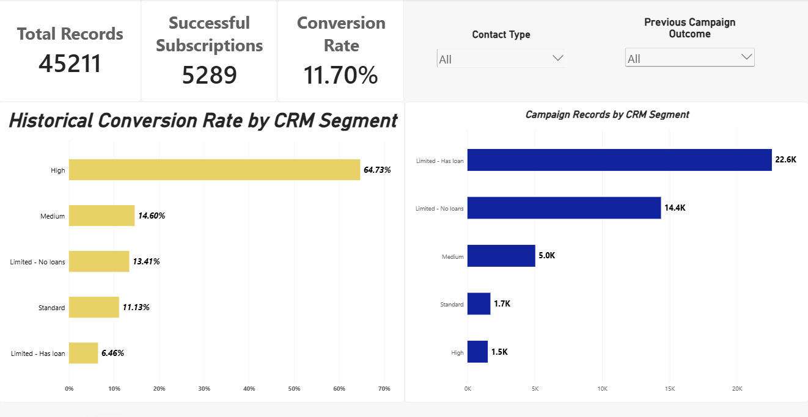
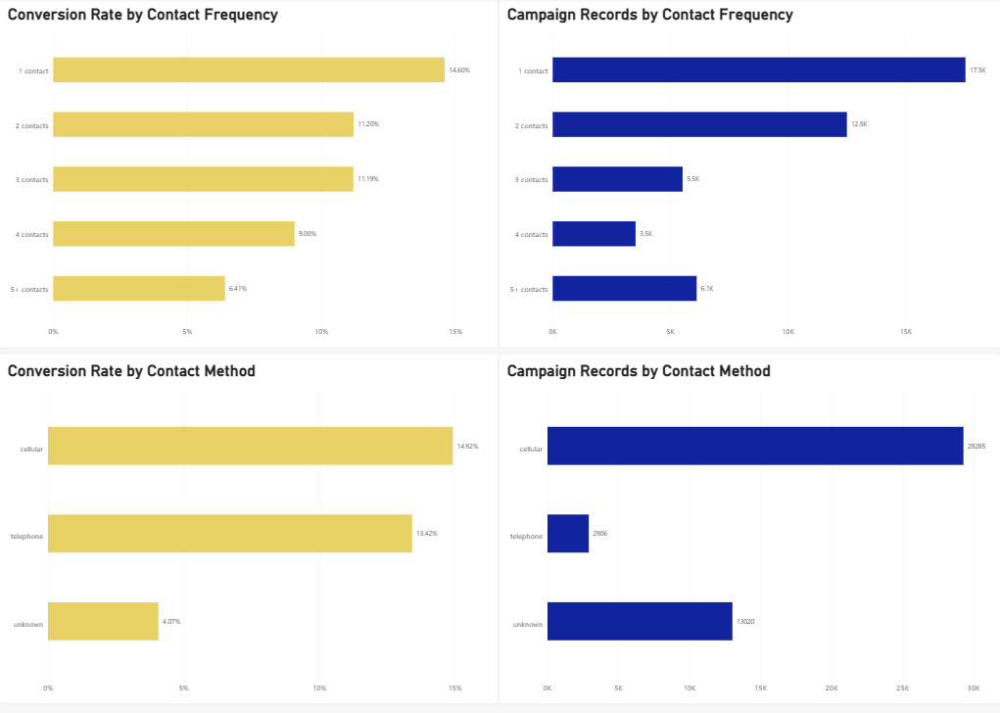

Bank Marketing Analytics & CRM Decision Support
SQL + Google BigQuery + Power BI | Business Intelligence | Exploratory CRM Segmentation
An end-to-end business analytics portfolio project examining 45,211 historical bank marketing campaign records and developing a rule-based CRM segmentation prototype to support analysis of outreach and term-deposit subscription patterns.
> **Project scope:** This is a historical decision-support demonstration—not a deployed CRM, a validated predictive model, or evidence of increased sales.
Project overview:
A Portuguese bank conducted direct-marketing campaigns promoting term deposits. The business questions explored here are:
Which recorded contact methods and previous campaign outcomes are associated with higher subscription rates?
How do current-campaign contact frequency and previous contact history relate to outcomes?
Can simple, transparent CRM segmentation rules organize campaign records into groups with meaningfully different historical conversion rates?
How can these findings be communicated to decision-makers through interactive dashboards?
The analysis uses the UCI Bank Marketing dataset (`bank-full.csv`). The unit of analysis is a campaign record, not a confirmed unique customer.
Dashboard previews
Page 1 — CRM Executive Overview

The report includes subscription KPIs, segment-level conversion and record volume, and interactive contact-method and prior-campaign-outcome filters.
Page 2 — Campaign Operations

This page compares historical conversion rates and campaign record volumes by number of contacts and contact method.
Open the Power BI report file (requires Power BI Desktop to explore locally).
Technologies and methods
Tool	Use
Google BigQuery / SQL	Importing data; descriptive analytics; aggregation; `CASE`, `GROUP BY`, common table expressions, window functions, and reusable views
Power BI Desktop	Interactive two-page report, KPI cards, slicers, and bar charts
DAX	Measures for campaign-record count, successful subscriptions, and conversion rate; calculated contact-frequency groups
GitHub	Versioned SQL scripts, project documentation, Power BI report, and dashboard screenshots
Key findings
The following figures were checked against BigQuery query results during the project.
Metric	Historical result
Campaign records	45,211
Successful term-deposit subscriptions	5,289
Overall record-level subscription rate	11.70%
Cellular contact conversion rate	14.92%
Telephone contact conversion rate	13.42%
Unrecorded/unknown contact-method conversion rate	4.07%
Records with previous campaign success: conversion rate	64.73%
Records with one contact in the current campaign: conversion rate	14.60%
Records with five or more contacts in the current campaign: conversion rate	6.41%
Interpretation: These are observed associations, not causal estimates. For example, more contacts may occur because some customers are harder to convert. A higher observed rate for a contact method does not prove that method caused the difference.
Exploratory CRM segmentation
Two rule-based BigQuery views were created:
Version 1 — segment records using the result of a previous marketing campaign and the number of previous contacts.
Version 2 — retain the Version 1 groups, but subdivide the large limited-history group by recorded housing-loan or personal-loan status.
Version 2 — observed performance
Segment	Records	Subscriptions	Historical conversion	Lift vs. overall
High	1,511	978	64.73%	5.53×
Medium	5,034	735	14.60%	1.25×
Limited – No loans	14,365	1,926	13.41%	1.15×
Standard	1,707	190	11.13%	0.95×
Limited – Has loan	22,594	1,460	6.46%	0.55×
Lift here is a segment's historical conversion rate divided by the overall historical conversion rate. It does not measure improvement caused by deploying the rules. The priority names are exploratory labels rather than a validated outreach ranking; in particular, the Limited – No loans group has a higher observed rate than Standard.
The rules are documented in `sql/08_create_crm_priority_v1.sql` and `sql/11_create_crm_priority_v2.sql`. All 15 organized SQL scripts are available in the `sql/` folder.
Data-quality review
No SQL `NULL` subscription outcomes, Version 2 segment assignments, or housing/personal-loan statuses were found in the fields checked.
13,020 records (28.80%) have `contact = 'unknown'`.
36,959 records (81.75%) have `poutcome = 'unknown'`; 36,954 of these have zero previous contacts. This is primarily limited prior campaign history—not necessarily missing data.
The source does not supply a unique customer identifier, so we do not equate records with distinct customers.
The audit SQL is `sql/14_data_quality_audit.sql`.
Preliminary stability check and important limitations
A random 50/50 split of the existing records produced similar descriptive conversion patterns across the five segments. This is not independent predictive validation: the rules were chosen after inspecting outcomes in the same full dataset and then compared on a later split.
Additional limits include:
No future-performance claim: These rules have not been assessed on genuinely untouched or prospective campaign data.
No causal claim: Contact method, contact frequency, and loan status have not been shown to cause differences in subscription outcomes.
No measured financial impact: There is no verified incremental revenue, savings, or ROI attributable to this prototype.
Responsible use: Loan-related segments are exploratory and require careful legal, fairness, customer-suitability, and business review before any operational use.
Historical context: The dataset represents historical campaigns at a Portuguese banking institution; results should not be generalized automatically to present-day banks.
See `sql/15_random_split_stability_check.sql` for the preliminary check.
Business recommendations to test
Pilot engagement-history-based lead review. Consider prior successful campaign outcomes as one input to a human-reviewed outreach experiment, measuring performance on newly collected campaigns.
Review follow-up processes. Investigate why high contact counts coincide with lower historical conversion; test outreach policies rather than assuming fewer calls are inherently better.
Improve contact-data capture. Review the `unknown` contact-method category and distinguish unavailable, unrecorded, and inapplicable values in CRM workflows.
These are proposals for future testing, not outcomes achieved by this project.
Repository contents
```text
bank-marketing-crm-analytics/
├── README.md                              # Main project overview
├── Bank_Marketing_CRM_Dashboard.pbix      # Power BI Desktop report
├── sql/                                   # 15 analysis, segmentation and audit scripts
│   └── README.md                          # Script run order and assumptions
├── screenshots/
│   ├── crm-executive-overview.png
│   └── campaign-operations.png
├── docs/
│   ├── project_notes.md
│   └── README.md
└── powerbi/
    └── README.md
```
Reproducing the analysis
Download the source data from the UCI Bank Marketing repository. Use `bank-full.csv` from `bank.zip`.
Create a Google BigQuery project and dataset, and import the CSV as `bank_campaigns_raw`. The file uses a semicolon (`;`) separator and a header row. In this project's BigQuery import, `y`, `housing`, and `loan` were detected as BOOLEAN fields.
Run the exploratory SQL files in `sql/`. Run `08_create_crm_priority_v1.sql` before `11_create_crm_priority_v2.sql`; evaluation queries that refer to those views must run after view creation. Change the hard-coded Google Cloud project ID as needed.
Use Power BI Desktop to open the `.pbix` report. If refreshing data, configure your own BigQuery connection and credentials; the original BigQuery project may not be accessible to others.
Documentation note: The SQL scripts were reconstructed and organized from queries developed during the project rather than exported verbatim from BigQuery's saved-query interface. Verify them against the original saved queries if exact execution provenance is required.
Data source and attribution
Moro, S., Rita, P., & Cortez, P. (2014). Bank Marketing [Dataset]. UCI Machine Learning Repository. https://doi.org/10.24432/C5K306
Dataset page: https://archive.ics.uci.edu/dataset/222/bank+marketing
The UCI source lists the data under a CC BY 4.0 license. Dataset credit belongs to the original creators.
